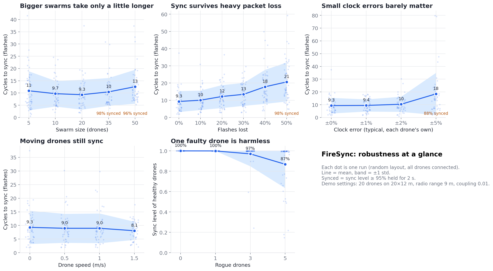

# FireSync

**Firefly-Inspired Timing Sync for Drone Swarms**

Bio-Inspired Engineering — Experiential Learning, RV College of Engineering.



---

## What this is

Fireflies flash in unison with no leader. Each one nudges its own rhythm
forward a little whenever it sees a neighbour flash, and the whole swarm
falls into step.

Indoor drone swarms have the same problem. Outdoors they use GPS as a shared
clock; inside warehouses, tunnels and mines GPS does not reach, and without
shared timing they talk over each other and lose messages.

This project builds a **virtual swarm of 20 drones on a laptop** and connects
**a real ESP32 board with six LEDs over Wi-Fi** — each LED is its own firefly.
Everything falls into one rhythm with no leader, and we test how far that
holds up: bigger swarms, lost messages, drifting clocks, moving drones,
walls, and faulty drones.

## The research gap

Leaderless synchronization has been shown in theory (Nature Communications,
2024), in drone-network simulations (IEEE Transactions on Wireless
Communications, 2024), across wired datacenter servers (ACM SIGCOMM, 2025),
on real drones with external tracking (IEEE BalkanCom, 2025) and on special
sensor radios (ACM SenSys, 2005).

**Nobody has tested leaderless firefly sync on cheap ESP32 Wi-Fi.**
That is what we test. See `docs/ALGORITHM.md` for the papers.

## Quick start (Windows)

Double-click in the repo folder:

| File | What you get |
|---|---|
| `run_sim.bat` | the virtual swarm (first run sets up `.venv`, ~2 min) |
| `demo_fake_esp32.bat` | swarm + a pretend ESP32 with 6 LEDs, no hardware needed |
| `demo_esp32.bat` | swarm + the real ESP32, found automatically on the hotspot |

Or by hand:

```bash
pip install -r requirements.txt
python -m pytest                          # 76 tests, all must pass
python scripts/run_sim.py                 # virtual swarm in a window
python scripts/run_live.py                # swarm + real ESP32 (auto-discovery)
python scripts/fake_esp32.py              # pretend ESP32 (run in a 2nd terminal)
python scripts/run_sweep.py               # all experiments, ~1 min
python scripts/plot_results.py            # figures into data/figures/
```

## In the window

| Key | Does |
|---|---|
| **W** | wall up: two rooms that can't hear each other → two rhythms |
| **D** | open a doorway in the wall → the rooms merge into one rhythm |
| **X** | rogue (faulty) drones firing at random: 0 → 1 → 3 → 5 |
| **C** | clock drift: every drone's clock ±2 % fast or slow |
| **M** | drones move around (0.8 m/s) |
| **P** | packet loss: 0 → 10 → 30 → 50 % of flashes lost |
| **R** | scramble everyone · **SPACE** pause · **L** radio links |
| **F** | fullscreen · **S** screenshot · **ESC** quit |

The right side shows the sync level (with cycles to sync and number of
rhythms), a phase map, the scenario switches, the ESP32 card (searching →
found → *x/6 LEDs in sync*, measured Wi-Fi delay) and the last 30 s of sync.
The same scenarios exist as flags: `--walls --door-open --rogues 3
--drift 0.02 --move 0.8 --loss 0.3`.

## Results (50 runs per setting)

| Experiment | Result |
|---|---|
| Swarm size 5 → 50 drones (same density) | 11 → 13 cycles to sync: barely grows |
| Packet loss 0 → 50 % | 9 → 21 cycles, 98 % of runs still sync |
| Clock drift ±0 → ±2 % / ±5 % | no change / 18 cycles, 88 % sync |
| Moving drones 0 → 1.5 m/s | no slowdown (9 → 8 cycles) |
| Rogue drones 1 / 3 / 5 | sync of healthy drones 100 % / 97 % / 87 % |
| Two rooms + 6 m doorway | separate rhythms merge in ~20 s |
| Real ESP32 on phone hotspot | median RTT 51 ms, one-way ≈ 26 ms, 100/100 replies |

Figures and the full table: `docs/results/`. Regenerate with the two
commands above (the sweep writes `data/sweep_*.csv`).

## Repository layout

```
firefly-sync/
├── fireflysync/        the Python package (all the logic lives here)
│   ├── oscillator.py   the firefly rule itself — pure, no I/O
│   ├── swarm.py        drones, positions, who hears whom, scenarios
│   ├── geometry.py     walls and the doorway
│   ├── metrics.py      sync level, time-to-sync, rhythms
│   ├── session.py      the run loop; joins the ESP32's LEDs to the swarm
│   ├── link.py         UDP link to the ESP32 (discovery, ping)
│   ├── view.py         live pygame window
│   ├── sweep.py        headless experiments → CSV
│   ├── channel.py      (Phase 3b) artificial delay
│   └── reachback.py    (Phase 3b) Reachback Firefly Algorithm
├── scripts/            things you run
├── firmware/           Arduino sketches for the ESP32
├── analysis/           plotting code
├── docs/               PLAN, ALGORITHM, HARDWARE, DEMO, EXPERIMENTS, results/
├── tests/              unit tests
└── data/               run logs and fresh figures (not committed)
```

## Who does what

- **Code** (simulation, window, experiments): Kushal. AI agents: read `AGENTS.md` first.
- **ESP32 build** (wiring, flashing, hotspot): follow `docs/HARDWARE.md` step by step.
- **Demo day**: `docs/DEMO.md`.

## Status

| Phase | What it delivers | State |
|-------|------------------|-------|
| 0 | Wi-Fi round-trip latency test | done — 51 ms median RTT on phone hotspot |
| 1 | Virtual swarm that synchronizes, on screen | done |
| 2 | Real ESP32 joins over Wi-Fi | done — 6 LEDs, auto-discovery, measured delay; hardware run of the 6-LED firmware next |
| 3a | Scenarios + experiments + figures | done |
| 3b | Reachback algorithm vs plain rule under delay | not started |

## Licence

MIT — see `LICENSE`.
